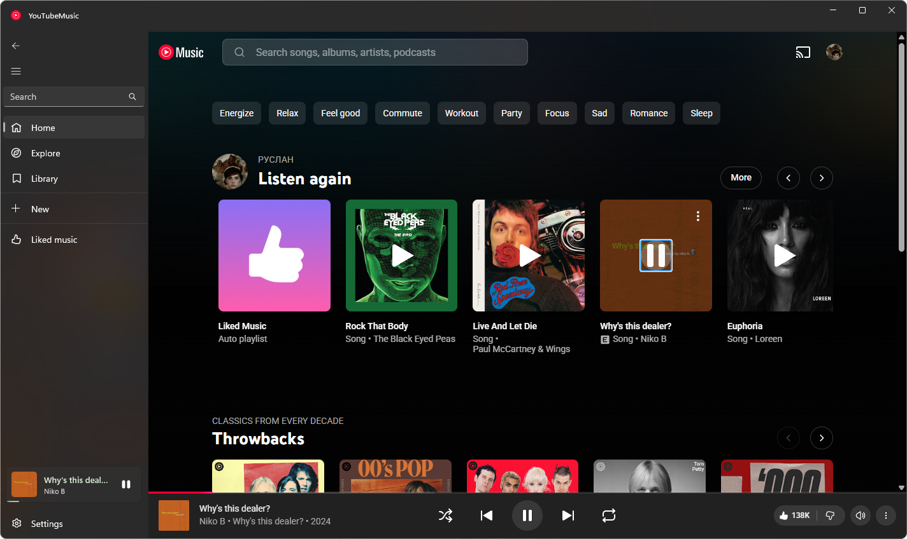

  
  

  

   
   

  

    
    
    
    
    
  

## About

> YouTubeMusic-WINUI integrates the YouTube Music web interface into a native Windows desktop shell, combining Windows 11 Fluent Design materials, synchronized lyrics, audio enhancements, and ad blocking.

 

  

## Features

<table>
  <tr>
    <th width="50%">Interface & Design</th>
    <th width="50%">Lyrics & Fullscreen</th>
  </tr>
  <tr>
    <td valign="top">
      <ul>
        <li><b>Windows 11 Materials</b>: Support for <code>Mica</code>, <code>Mica Alt</code>, and <code>Desktop Acrylic</code> backdrops.</li>
        <li><b>Theme Customization</b>: System, Dark, and Light themes.</li>
        <li><b>Flexible Navigation</b>: Switch between a left sidebar and a compact horizontal top menu.</li>
        <li><b>Integrated Mini-Player</b>: Embedded playback controls inside the sidebar and top bar.</li>
        <li><b>Search & History</b>: Search suggestions with local query history.</li>
      </ul>
    </td>
    <td valign="top">
      <ul>
        <li><b>Synchronized Lyrics</b>: Real-time time-synced and plain lyrics from the LRCLIB database.</li>
        <li><b>Auto-Scroll & Seek</b>: Automatic line following with click-to-seek functionality.</li>
        <li><b>Lyrics Translation</b>: In-app real-time translation into selected languages with exclusion filters.</li>
        <li><b>Fullscreen Mode</b>: Dedicated player screen with animated blurred album artwork background.</li>
      </ul>
    </td>
  </tr>
  <tr>
    <th width="50%">Playback & Enhancements</th>
    <th width="50%">Network & Privacy</th>
  </tr>
  <tr>
    <td valign="top">
      <ul>
        <li><b>AdBlock</b>: Suppresses video advertisements and promotional banners.</li>
        <li><b>SponsorBlock</b>: Automatically skips sponsored segments, intros, and outros.</li>
        <li><b>Audio Crossfade</b>: Smooth volume transitions between tracks.</li>
        <li><b>Quality Control</b>: Forced maximum audio bitrate and configurable video resolution.</li>
      </ul>
    </td>
    <td valign="top">
      <ul>
        <li><b>Bypass Restrictions</b>: Integrated local Sing-box SOCKS5 proxy to access YouTube Music in restricted regions.</li>
        <li><b>Single-Click Toggle</b>: Enable or disable the proxy directly from the settings page without affecting system-wide VPN.</li>
      </ul>
    </td>
  </tr>
</table>

## Synchronized Lyrics & Translation

  

YouTubeMusic-WINUI integrates a dedicated lyrics module powered by the LRCLIB database:

- **Real-Time Synchronization**: Lyrics scroll automatically line-by-line following the track playback.
- **Click-to-Seek**: Click on any lyric line to jump playback directly to that timestamp in the song.
- **Live Translation**: Translate lyrics line-by-line into your chosen language in real time while preserving the original time sync.
- **Language Exclusion Filter**: Specify languages you do not want translated (e.g. your native language).
- **Dual Mode Support**: Synchronized karaoke-style display or standard static text when timed lyrics are unavailable.

## Requirements

| Component | Requirement |
| :--- | :--- |
| **Operating System** | Windows 10 (version 1809 / build 17763 or newer) or Windows 11 |
| **Runtime** | Microsoft Edge WebView2 Evergreen Runtime |

## License

This project is licensed under the [MIT License](LICENSE).
